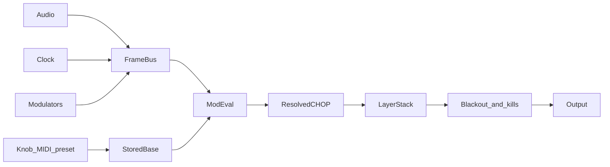

# Roy G Viz (RGV) — System Plan

Nov 7, 2026 · @Tim
Revised Nov 8, 2026

## Overview

Build one TouchDesigner project, Roy G Viz (RGV), that works like a Resolume composition: a stack of layers, each holding a swappable generator and an FX chain, mixed into a master with its own FX. Every parameter has a base value you set by hand and modulation slots that add on top.

Design principles:

- **One parameter contract.** Every exposed parameter is normalized 0–1 internally. Floats and ints have a stored base, a resolved value, and a mapped output. Up to 4 modulation slots apply to the base.
- **Modules with a fixed interface.** Generators and FX are COMPs with known inputs, outputs, a params table and a manifest, so swapping one is a menu change. Library toxes find the project through the parent shortcut `parent.Rgv`.
- **One control bus.** All control signals (audio, clock, LFOs, MIDI, macros) live on a single frame-rate CHOP bus. Every channel publishes a name, a range, and a polarity. Modulatable channels are normalized before any slot uses them.
- **State is data.** Presets, mappings and palettes are JSON or table DATs. Recall selects among preloaded modules and writes values. It does not rebuild the network.
- **Hands beat machines.** A physical control holds off modulation on its parameter while the hand is on it, then brings modulation back after release.
- **Python for structure, CHOPs and GLSL for signal.** Python rebuilds data and handles events. One bounded per-frame Execute DAT may drain a thread-safe queue into CHOPs. Per-frame math stays in CHOPs and GLSL.

## Architecture

RGV has two halves. The control half turns audio, tempo and controllers into named channels on one bus. The render half is a Resolume-style stack: per layer, a generator runs through an FX chain into a blend, then all layers go through master FX to the output.

The mod evaluator is the only bridge between the halves. It reads bases and the bus, writes a resolved CHOP, and exports mapped values to operator parameters.



Network layout in TouchDesigner:

- `/rgv/control` — `audio`, `clock`, `midi`, `mods`, `bus` (Null CHOP, one sample per frame), `mod_eval`
- `/rgv/layers/layer1–4` — `gen_bank`, `fx_slots`, `out`
- `/rgv/master` — `mix`, `fx_slots`, `out`
- `/rgv/data` — `palettes`, `presets`, `midi_map`, `mod_matrix`, `bus_schema`
- `/rgv/library` — generator and FX .tox files
- `/rgv/ui` — operator panels

`parent.Rgv` is the RGV COMP. A tox references the bus, the palette, and the resolution through that shortcut. Paths inside a tox stay on `parent.Rgv` and on sibling names.

## Parameter contract

Every modulatable float resolves in three steps. The base is stored in normalized space. Slots update a running value. The curve and the real range are applied after the clamp.

1. Start from the stored base `b` in 0–1.
2. Apply slots 1 through 4 in order. Each slot reads the running value, so a later replace wins.
3. Clamp to 0–1, apply the curve, then map into the parameter's min and max.

Depth `d` is a fraction of remaining travel, from −1 to 1. One slot at full depth reaches an end of the range and stops there. The clamp is a safety net after all four slots.

Adapt the source to the mode before the math. Add-bipolar expects `n` in −1–1; a unipolar source `u` becomes `n = 2u − 1`. Every other mode expects `u` in 0–1; a bipolar source becomes `u = n · 0.5 + 0.5`.

| Mode | Running value `v` |
| --- | --- |
| Add bipolar | `v + d · n · (1 − v)` when `n ≥ 0`, else `v + d · n · v` |
| Add unipolar | `v + d · u · (1 − v)` when `d ≥ 0`, else `v + d · u · v` |
| Multiply | `v · ((1 − abs(d)) + abs(d) · m)`, with `m = u` when `d ≥ 0` and `m = 1 − u` when `d < 0` |
| Replace | `v + abs(d) · (u′ − v)`, with `u′ = u` when `d ≥ 0` and `u′ = 1 − u` when `d < 0` |

A slot may also store a min and max in 0–1. After that slot, the running value is clamped to that sub-range.

Smoothing is a per-slot time in milliseconds on the source, applied before the mode math. There is one smoother, on the source. The summed value is not lagged again.

The curve runs on the clamped 0–1 value and produces the mapped output `p`:

| Curve | Map |
| --- | --- |
| lin | `p = min + v · (max − min)` |
| exp | `p = min · (max / min) ^ v` when min and max are both positive. Otherwise `p = min + (max − min) · v ^ 2` |
| log | `p = min + (max − min) · log(1 + v · 9) / log(10)` |

Knobs, MIDI, and presets store the linear base `b`. The mod ring draws the resolved value `v`, still in 0–1, so the ring matches knob travel. Operators read `p`.

### Three values, one custom parameter

TouchDesigner custom parameters hold a single value. That value is the stored base.

| Value | Where it lives | Who writes it |
| --- | --- | --- |
| Stored base | The module's custom parameter | The knob, a learned MIDI or OSC binding, a preset morph |
| Resolved value | A channel on the resolved CHOP | `mod_eval` |
| Mapped output | An export or an expression on the target operator parameter | A reference to the resolved channel, then the curve and range |

`mod_eval` reads the custom parameter. It does not Bind the custom parameter back to the resolved CHOP. A Bind there writes the modulated number into the base, and the next frame modulates it again.

ParamEngine creates custom parameters when a module loads, from its `params` table, and registers each address in the matrix. Preset recall sets bases. It does not rebuild parameter pages. Rebuilding pages is an edit-time action after the table itself changes.

### Types

| Type | Resolution |
| --- | --- |
| float | The full slot formula |
| int | The float map, then round to the nearest integer in the real range. The base stays 0–1 |
| toggle | Base 0 or 1. An optional single gate slot forces the output on while its unipolar source is at or above 0.5. Extra slots and depth are unused |
| menu | Base only, stored as the menu token. Menus are not mod targets |
| pulse | No stored value. One slot fires on the rising edge of a pulse channel (crosses 0.5 for one frame). Depth is unused. Pulses do not morph |

### Declaration, addresses, grab

Each module lists its parameters in a `params` table DAT: name, label, min, max, default, curve (lin, exp, log), type (float, int, toggle, menu, pulse), page, and an optional `role`.

Roles are the shared semantic names a generator may opt into: `speed`, `scale`, `complexity`, `color_offset`, `brightness`. A mod route follows a role across a generator swap only when that route's `follow_role` flag is set. Otherwise the route stays saved against its module id and goes inactive until that module is active again.

Addresses are used by the MIDI map, presets, OSC, and the mod matrix:

`layer2/gen@noise_field/scale`
`layer2/fx1@kaleidoscope/mix`
`master/fx3@glow/amount`
`palette/shift`

The token after `@` is the module id from the manifest. `palette/shift` and other project-level parameters have no module id because they are not swappable.

Slot fields, one row per slot in `mod_matrix`: target address, slot index, source channel, depth, mode, smoothing in ms, optional swing min and max, `follow_role`.

**Grab.** When a physical control is bound to a base (a panel knob, a fader, an absolute MIDI or OSC control), modulation on that address scales to 0 while the control is touched and returns linearly over the release time. Default release is 250 ms. A parameter with no physical binding leaves grab off. A preset morph writes bases from the preset player and does not count as a touch, so modulation keeps running during the morph.

**Learned controls write one destination.** An absolute, relative, toggle, momentary, or trigger binding writes the base or fires the pulse. That control is not also published on the bus. Unbound messages, and controls explicitly marked as mod sources, publish `midi/<device>/<id>` already normalized to 0–1. One physical control is either a base writer or a bus source.

## Bus schema

The bus is one Null CHOP at the project frame rate, one sample per frame. Audio-rate work stays inside the audio COMP and is reduced before it is published. Pulse channels are 0 or 1 for a single frame. Consumers read the bus every frame.

`bus_schema` lists every channel: name, min, max, polarity (`uni` 0–1 or `bi` −1–1), and a modulatable flag. `mod_eval` normalizes from that row. A channel with the flag clear is for display and clock math and is rejected as a slot source.

| Channel | Range | Polarity | Mod source |
| --- | --- | --- | --- |
| `audio/level`, `audio/low`, `audio/mid`, `audio/high` | 0–1 | uni | yes |
| `audio/kick`, `audio/hat` | 0 or 1, one frame | uni | yes, as pulses |
| `audio/breakdown` | 0 or 1, sustained | uni | yes |
| `clock/bpm` | ramp BPM (felt on Internal/Tap, session BPM on Pro DJ Link) | raw | no |
| `clock/feel` | 0.5, 1, or 2 | raw | no |
| `clock/beat`, `clock/bar` | 0–1 | uni | yes |
| `clock/beat_pulse`, `clock/bar_pulse` | 0 or 1, one frame | uni | yes, as pulses |
| `lfo1`–`lfo8` | −1–1 | bi | yes |
| `env1`–`env4` | 0–1 | uni | yes |
| `seq1`, `seq2` | 0–1 | uni | yes |
| `macro1`–`macro8` | 0–1 | uni | yes |
| `rand1`–`rand4` | 0–1 | uni | yes |
| `midi/*`, `osc/*` | 0–1, unbound sources only | uni | yes |
| `prolink/deck1–4/onair` | 0 or 1 | uni | yes |
| `prolink/master_deck` | deck index | raw | no |
| `prolink/phrase` | 0 when no analysis, else a step id | raw | no |

Phrase and deck index stay off the mod matrix. A derived 0–1 channel can be added later if a look needs them. `clock/bpm` is never a slot source; a depth times 120 would pin the clamp.

## Modulation evaluator

One `mod_eval` COMP evaluates every float and int address. Adding a route writes table rows and coefficient channels. It does not create operators.

The network is fixed:

1. A Select gathers the bus channels the matrix currently references.
2. Those channels, the bases, and the slot rows (depth, mode, smoothing, swing limits, grab gain) are packed into TOPs.
3. A GLSL TOP, shader on disk, adapts polarity, smooths each source with its own millisecond time (one-pole, state in a feedback TOP), applies the four modes in slot order, applies grab gain, and clamps.
4. A TOP to CHOP writes the resolved channels, named from the address. These are the pre-curve 0–1 values the mod rings read.
5. The same shader writes mapped channels: curve, range, then a round into the real range for int parameters. Operators export those channels.

Channel count is data. The operator count stays put. Reserve 512 addresses. Past that, extra parameters hold at their base and the UI shows a warning.

Each module Selects its own resolved channels by name and exports them to its operator parameters.

### Stage order

Evaluation is staged so a modulator can drive a target, and so a cycle has a defined delay.

1. **Sources.** Audio and clock publish the bus.
2. **Modulators.** LFOs, envelopes, sequencers, random, and macros read the bus and write their channels. Their own rate, depth, and shape are parameters. Those parameters use last frame's mapped values, held through a feedback. A modulator that reads another modulator on this same stage also sees last frame's bus.
3. **Targets.** `mod_eval` reads this frame's bus and the current bases, and writes the resolved CHOP.
4. **Hard switches.** These are not matrix addresses, so a slot cannot undo them. Global mod amount multiplies every depth inside the shader. Freeze makes the shader repeat the previous resolved frame. Per-layer bypass, per-FX bypass, global FX kill, and blackout are Switch or Level operators after the stack.

The one-frame delay is the cycle breaker. LFO rate driven by another LFO is legal and is one frame late. Same-frame cook loops are out of the design.

Global mod amount, freeze, bypass, FX kill, and blackout are performance latches. Scene recall leaves them where the operator set them.

**Mutate** randomizes the float bases of the selected layer inside each parameter's 0–1 range. It leaves menus, toggles, module choice, and the matrix alone. It is Shift plus its pad. One undo step restores the previous bases until the next mutate or the next scene recall.

## Cooking

A Switch TOP with Blend between Inputs carries generator transitions. When the index is an integer, only that input cooks. The index returns to an integer as soon as the crossfade ends, and the idle bank slot goes cold. A Cross TOP is not used to pick generators, because a Cross TOP keeps cooking both inputs while it is displayed.

The dry/wet Mix on an FX slot is a Cross TOP between that slot's input and that slot's processed output. That is the one place a Cross is the right tool: the wet branch is the work the mix exists to show. Bypass and an empty slot are a Switch TOP back to the dry input at an integer index, so a bypassed effect stops cooking. Global FX kill forces those switches to dry.

Viewers on idle bank slots and idle FX instances stay off. A viewer flag cooks that branch even when the Switch has moved on. Layer thumbnails sample a Resolution TOP at 256 pixels wide on the live layer out, after the switch, so the UI does not pull every bank slot at project resolution.

Each occupied FX slot holds one instance. The slot's Switch selects pass-through or that instance. Reorder swaps the instance each slot points at by updating select paths in `fx_chain`, between frames. The operators stay connected. Dragging a slot does not rewire the chain.

`onActivate` and `onDeactivate` are for starting and stopping playback inside a module (a movie's `cue`, a particle reset). Cook state follows the Switch. A callback does not toggle `allowCooking`.

Deactivating a generator, unloading a tox, and picking up a new file from `library` are edit-time actions. A show recall only changes a switch index among modules already in the bank.

### Bit depth and alpha

Module outputs are 8-bit RGBA, premultiplied. A manifest may set `hdr`. That module may run 16-bit inside its own network and converts back to 8-bit premultiplied on its `out1`. The master output is 8-bit. Feedback and glow are the expected `hdr` modules.

Every generator and FX composites in premultiplied alpha.

| Blend | RGB | Alpha |
| --- | --- | --- |
| Over | premultiplied over | standard over |
| Add | add, then clamp | max of the two alphas |
| Screen | screen | alpha of the upper layer |
| Multiply | multiply | alpha of the upper layer |
| Difference | absolute difference | alpha of the upper layer |

A resolution change pulses Reset on every Feedback TOP (tunnels, trails, and the evaluator's smoothing state) in the same frame the resolution source changes. `out1` takes its resolution from `parent.Rgv`. Internal TOPs use their input resolution, starting from a resolution reference at the top of the tox.

## Audio analysis

One `audio` COMP turns the input into bus channels and an FFT texture. Analysis runs at audio rate. What hits the bus is one sample per project frame.

1. **Input.** Audio Device In CHOP for live, Audio File In CHOP for rehearsal, picked by a menu. If the device is busy, the menu falls back to the file input, the file plays silence until a clip is chosen, and the top bar shows a warning. The output keeps running. Sum to mono as `0.5 · (L + R)`.
2. **Gain.** Math CHOP for input gain in dB. Optional auto-gain: a slow peak follower that pulls the signal toward a target level. The follower memory is runtime state. Presets store the auto-gain amount and leave the follower where it is.
3. **Band split.** Low is a low-pass at the low crossover, 24 dB/oct. High is a high-pass at the high crossover, 24 dB/oct. Mid is a band-pass with center `sqrt(low · high)`, bandwidth `high − low`, 24 dB/oct.
4. **Envelope.** Analyze CHOP (RMS) per band at audio rate. A peak-hold keeps the max across each project frame, and that max is the frame-rate sample. The display envelopes then take a Lag with separate attack and release.
5. **Band gain.** Math CHOP per band, after the frame reduce, before the display lag.
6. **Clean-up.** Gate the display envelopes below a noise floor, then Limit to 0–1.
7. **Onsets.** Kick and hat are a separate audio-rate path: the derivative of a short (unlagged) envelope, a threshold, and a peak-hold, published as a one-frame pulse. They do not read the lagged display envelopes.
8. **Breakdown.** Low-band average into a Trail window, then depth = max − min over that buffer. When depth is below the breakdown threshold, publish `audio/breakdown` = 1 for the whole section (sustained gate, not a one-frame pulse). Does not use lagged display envelopes.
9. **FFT texture.** 1024-point spectrum. The texture is 512×1, R channel only, so it stays a one-pixel-tall ramp under the Non-Commercial width exemption. Horizontal position is log frequency from 20 Hz to Nyquist. Level is dB from −80 to 0, mapped to 0–1. Generators sample `x` as log frequency and read R. No generator assumes a 2D spectrogram.
10. **Out.** The frame-rate channels merge into the bus. Meters in the UI read the same channels.

| Parameter | Range | Default | Curve |
| --- | --- | --- | --- |
| Input gain | −24 to +24 dB | 0 dB | lin |
| Low crossover | 60–300 Hz | 150 Hz | exp |
| High crossover | 1.5–6 kHz | 2.5 kHz | exp |
| Band gain (low, mid, high) | 0–4× | 1× | lin |
| Attack (per band) | 0–200 ms | 10 ms | lin |
| Release (per band) | 20–2000 ms | 150 ms | lin |
| Noise gate | 0–0.2 | 0.02 | lin |
| Onset threshold | 0–1 | 0.5 | lin |
| Breakdown window | 0.5–16 s | 4 s | lin |
| Breakdown threshold | 0–1 | 0.05 | lin |

These are contract parameters. Crossover uses the exp map so knob travel is musical. Every Lag and filter time in this COMP is in milliseconds, so a project fps change does not retune the feel.

## Tempo and clock

One `clock` COMP owns tempo and phase and publishes the `clock/*` channels. Everything synced reads those channels.

| Source | How | Notes |
| --- | --- | --- |
| Internal | Free-run phase engine driven by a BPM parameter | Default, and the fallback |
| Tap | Keyboard, pad or UI button into a Python tap handler | Average the last 4–8 taps, drop taps more than 15% off, reset after a 2 s gap |
| Pro DJ Link | TD ProLink, inside TouchDesigner | Follows the master deck via `PushPacket`. See below |

`clock/bpm` is the tempo the beat ramp is built from, and `clock/beat` is that ramp. Half and double set `clock/feel` to 0.5, 1, or 2. `clock/bar` stays on the source signature so downbeats still match the session.

On Internal and Tap, feel multiplies the local BPM, `clock/bpm` shows that felt tempo, and the ramp runs at the felt rate. On Pro DJ Link, `clock/bpm` stays at the session tempo and only `clock/beat` and `clock/beat_pulse` run at `feel` times that tempo. The session BPM is left alone, so a half-time look does not push a halved tempo back at the players. Feel is applied once, in the place that matches the source. Packet ingest (`ClockExt.PushPacket`) and phase slew ship before Pro DJ Link is connected so the network adapter only has to feed packets.

**Signature.** A clock setting, default 4/4. Bar length is this local value. Pro DJ Link bar position uses beat-within-bar when the player sends it, interpreted in this same signature.

**Downbeat.** A Resync button sets beat phase to 0. That is the only hard reset.

**Nudge.** Hold-to-nudge buttons shift phase without changing BPM. On Pro DJ Link, nudge is an extra latency bias for the visual clock.

**Dropout.** If a network source goes silent for 2 s, hold the last BPM, keep the ramp free-running, and show a warning in the tempo bar. The source the operator picked stays selected. When packets return, the clock rejoins that source and phase slews onto the new packets. It does not snap.

### Phase slew

Each frame the ramp advances by `bpm / 60 · dt`. When a beat packet arrives, the error is the wrapped distance from the local phase to the packet phase, in −0.5 to 0.5. The ramp moves 25% of the way toward the packet, and never more than 10 ms of phase in one frame. Latency offset is a constant milliseconds bias added after that correction, to cover network, render, and projector delay. Set it by eye at soundcheck.

Between packets the ramp free-runs from the current BPM (effective BPM on Pro DJ Link, including pitch). The next packet corrects through the same slew.

### Pro DJ Link inside TouchDesigner

Pro DJ Link runs inside the project. A `prolink` adapter listens to the players and writes the same `clock/*` channels as every other source.

The show build uses TD ProLink, a .tox that runs the stack on background threads. The open-source python-prodj-link library is a development reference only. It is not installed on a show machine and it is not a runtime fallback.

- **Threads stay off the network.** The network thread never touches operators. It pushes packets into a thread-safe queue. A per-frame Execute DAT empties the queue into a Constant CHOP and table DATs. That drain is the one allowed per-frame Python path. It writes values. It does not run parameter math.
- **Follow the master.** Read BPM from the deck flagged as tempo master, using the effective BPM. A master handoff changes the source deck, and phase slews to the new deck.
- **When the master stops.** A menu sets what happens when the master pauses: hold BPM and keep the ramp running, or freeze the beat ramp. If packets stop for 2 s, the dropout rule above applies.
- **Extra channels.** Publish `prolink/deck1–4/onair`, `prolink/master_deck`, and `prolink/phrase` (0 when the track has no rekordbox analysis). Phrase does not recall a scene on its own. An operator can bind a phrase step to a scene with the usual quantize. Missing analysis publishes 0 and recalls nothing. Artwork, when present, is a TOP a generator may sample. When it is absent the TOP is black with alpha 0.

Network setup:

- The TouchDesigner machine must be on the same Ethernet network as the players. The library finds them through broadcasts.
- Without a DHCP server, give the machine an address in 169.254.0.0/16 to match the players.
- Choose the network interface explicitly. TD ProLink has a Localaddress parameter for this.
- Allow UDP ports 50000–50002 through the Windows firewall. To check traffic is arriving, look for the players' broadcasts on port 50000 with Wireshark.
- Rekordbox-exported USB sticks are needed for track metadata, artwork, and waveforms. Tempo and beat packets do not need them.
- Test on the actual booth setup before a show.

## MIDI and OSC learn

Learn binds any controller message to any address in two moves: arm a parameter, then touch the control. One learn flag covers the whole app. The APC learn button and the iControls record button both toggle that flag.

1. Press Learn. Learnable controls highlight in the UI.
2. Click a target: a base value, a mod slot's depth, a layer fader, or a trigger (tap, preset, resync, blackout, freeze).
3. Move a knob or hit a pad. A MIDI In DAT callback captures device, channel, message type, and number. LED feedback the app itself sent is ignored.
4. The binding is written as a row in `midi_map`. If that physical control was a bus source, it is removed from the bus. The target stops flashing.
5. Press Learn again to leave. Shift-click a control to clear its binding and return it to the factory profile, or to the bus, according to the profile.

- **Modes.** Absolute, relative (endless encoders), toggle, momentary, and trigger.
- **Relative.** Each tick adds a step to the base, default 1/128. Ticks closer than 30 ms use a ×4 step. Relative bindings have no pickup.
- **Pickup.** For absolute bindings, the base stays put until the incoming value crosses it. Each binding stores `armed` or `live` in the profile.
- **Range and curve.** Each binding can set min, max, and a curve into the normalized base. That curve is the binding's, and it is separate from the parameter curve that maps `v` to `p`.
- **Feedback.** MIDI Out lights pads and LED rings: active layer, preset slot, tap button flashing on the beat. Feedback is outbound. Learn does not treat it as input.
- **Profiles.** Maps are saved per controller as JSON, separate from presets, including pickup state. The same show runs on a different controller.
- **OSC.** The same learn flow works for OSC through an OSC In DAT. Continuous OSC that is learned writes bases. Unbound OSC publishes `osc/*` on the bus.
- **Signal path.** The DAT captures and dispatches events. A learned absolute control writes the base from the event. It does not also run through a MIDI In CHOP into the bus.

### Factory profile versus a learned override

Factory bindings for the iControls knobs 1–8 are slot-relative: knob N writes the Nth float or int row of the selected module's `params` table. Selection change retargets those knobs, with pickup, so a knob in the wrong place waits until it crosses the new base.

A learned binding is address-sticky. It keeps writing that address across selection changes, and it masks the factory slot binding on that physical control until the binding is cleared.

## Controller layout

Ship two default profiles so RGV plays out of the box. Each profile includes the controller-side file, not just the JSON map. `controllers/apc_mini_mk2` documents the generic MIDI layout RGV expects. `controllers/icontrols.icon` is the iMap dump: both layers, distinct CCs, on a channel the APC does not use, knobs sending absolute CC, transport buttons sending CC rather than MMC.

APC mini mk2 and iCON iControls are **alternate** factory profiles for one surface at a time. They stay on separate MIDI channels so either can be connected without relearning; a show does not assume both are driven together.

The APC mini mk2 is opened on its generic MIDI port. Ableton's control-surface script for that device stays disabled, so the script and RGV do not both drive LED state and fader mode.

MIDI learn can override any factory binding.

**APC mini mk2** (8×8 RGB pads, 9 faders, 8 clip-stop buttons, 8 scene buttons, plus the hardware Shift key)

| Control | Function | LED feedback |
| --- | --- | --- |
| Pads, columns 1–4 | Generator bank: one column per layer, 8 generators each | Dim = loaded, bright = active, off = empty |
| Pads, columns 5–8, rows 1–4 | 16 scene presets (hardware Shift + pad saves) | Palette color of the scene; flashes while morphing |
| Pads, columns 5–8, rows 5–6 | 8 palettes | Each pad shows its palette's main color |
| Pads, columns 5–8, rows 7–8 | Tap, resync, half, double, freeze, FX kill, mutate, blackout | Tap flashes on the beat. Mutate accepts the hit only while hardware Shift is held |
| Clip-stop buttons 1–4 | Select layer (the inspector and iControls follow it) | Lit on the selected layer |
| Clip-stop buttons 5–8 | Bypass layers 1–4 | Lit = bypassed |
| Scene buttons 1–6 | Bypass FX slots 1–6 on the selected layer | Lit = active |
| Scene button 7 | MIDI learn | Flashes while armed |
| Scene button 8 | Blackout | Lit while blackout is on |
| Hardware Shift | Save scene on a scene pad, and arm mutate | — |
| Faders 1–4 | Layer opacity | — |
| Faders 5–8 | Macros 1–4 | — |
| Fader 9 | Master level | — |

With 3 layers, column 4 and clip-stop buttons 4 and 8 go dark. Pad colors are set by sending note messages back to the APC. A color table is the LED state. v1 has 16 scene slots, the same 16 the pads can reach. The on-screen grid shows those 16.

**iCON iControls** (9 faders, 9 knobs, 18 buttons, 6 transport buttons, 4 internal layers)

| Control | Layer A: inspector + stack / clock | Layer B: audio and modulation |
| --- | --- | --- |
| Knobs 1–8 | First 8 float or int parameters of the selected module | LFO 1–8 rate |
| Knob 9 | Mix of the selected module | Input gain |
| Faders 1–4 | Layer 1–4 opacity | Low, mid, high gain; attack |
| Faders 5–8 | Macros 1–4 (macros 5–8 are UI / Learn only) | Release; gate; onset threshold; auto-gain amount |
| Fader 9 | Global mod amount | Palette shift |
| Top buttons 1–9 | Select module: generator, FX 1–6, master FX, palette | LFO 1–8 on/off, LFO sync on/off |
| Bottom buttons 1–4 | Select layer 1–4 | (unmapped in v1) |
| Bottom buttons 5–7 | Blackout, freeze, FX kill | (unmapped in v1) |
| Bottom buttons 8–9 | Tap, resync | (unmapped in v1) |
| Transport | Half / double feel, previous/next scene (noop until Presets), play/stop (noop until clock wiring), record = MIDI learn | Same |

- **Pickup.** Absolute faders and knobs use soft takeover. It is stored per binding and starts on.
- **Following selection.** Factory knobs 1–8 follow the selected module. Learned overrides stay on their address.
- **Setup.** Program both iControls layers from `controllers/icontrols.md` (distinct CCs and bottom notes on channel 2). The `.icon` dump is non-authoritative.

## Generator modules

A generator is a .tox COMP with one TOP out, a `params` table, and read access to the bus and palette through `parent.Rgv`. Swapping it changes the picture. The layer's FX chain and the address-sticky MIDI bindings stay put.

Each layer preloads a bank of up to 8 generators. One is active. A preset selects a bank index. The generator id is stored beside the index. On recall, if that id is loaded in a different slot, recall selects the slot with the id. If the id is not in the bank, the generator stays as it is and the UI warns. New toxes show up in the picker when the library is reloaded at edit time, then get placed in a bank slot.

Interface every generator follows:

- **Out.** `out1` TOP at the RGV resolution, 8-bit, premultiplied alpha. `hdr` modules convert to that on the way out.
- **In.** The bus (Select CHOP by channel name), the palette ramp TOP, and optionally the FFT texture and the artwork TOP.
- **Manifest.** A `manifest` DAT with name, id, version, tags, thumbnail, `hdr`, and its parameter list.
- **Roles.** A generator may tag parameters with `speed`, `scale`, `complexity`, `color_offset`, and `brightness`. Routes follow those roles only when `follow_role` is set. Movie speed and noise speed do not share a route by default.
- **Lifecycle.** `onActivate`, `onDeactivate`, and `onPresetLoad` for playback and local reset. Cook follows the bank Switch.
- **Resolution.** `out1` follows `parent.Rgv`. Internal TOPs use input resolution. A feedback generator resets its feedback on a resolution change.
- **Fit.** A source that has its own aspect (movie, NDI, Spout) has a per-generator fit: fill, fit, stretch, or 1:1, inside the RGV raster.

Transition time is 0 for a cut, or a number of beats. The bank Switch blends during the transition and lands on an integer index.

| Generator | Technique | Key parameters |
| --- | --- | --- |
| Spectrum bars | FFT texture into a GLSL TOP, sampling the 512×1 contract | Bar count, falloff, mirror |
| Waveform scope | Audio CHOP to line geometry, rendered | Thickness, persistence |
| Particle burst | GPU particles, emission on `audio/kick` | Emit rate, lifetime, turbulence |
| Feedback tunnel | Feedback TOP with Transform, `hdr` | Zoom, rotate, decay |
| Noise field | Noise TOP or GLSL fBm with domain warp | Octaves, warp |
| Instanced geometry | Geometry COMP instancing | Count, spread, rotation |
| Shader slot | User GLSL with uniforms exposed as parameters | Any uniform |
| Video input | Movie File In, NDI In, or Spout In on Windows. Syphon In on macOS | Speed, cue point, fit |

## FX modules

An FX is a .tox COMP with one TOP in, one TOP out, a `params` table, and a Mix parameter. Any FX can go in any slot on any layer or the master.

- **Fixed slots.** Each layer has 6 FX slots and the master has 8. Each occupied slot holds one instance. A Switch TOP selects that instance or the dry input when the slot is empty or bypassed.
- **Chain as data.** An `fx_chain` table per layer lists slot, module id, and bypass. Reorder swaps which instance a slot selects. The table rows, the bases, and the mod routes move with the module id.
- **Mix.** A Cross TOP between the slot input and the FX output. Bypass switches to the dry input at an integer index.
- **Controls.** Bypass and solo per FX. Solo is a performance latch: it bypasses the other slots on that layer until it is cleared, and it is not written into presets. Duplicate and drag-to-reorder are edit actions. Global FX kill forces every FX switch to dry.
- **Beat sync.** Route `lfo*` or `clock/*` channels to FX parameters through the matrix.

| FX | Build | Good mod targets |
| --- | --- | --- |
| Trails | Feedback TOP + Level, `hdr`, reset on resolution change | Decay, zoom |
| Kaleidoscope | GLSL | Segments, rotation |
| Mirror and tile | Flip, Tile or GLSL | Axis, count |
| Displace | Displace TOP fed by Noise | Amount, scale |
| Glow | Blur + additive Composite, `hdr` | Radius, threshold |
| RGB split | GLSL | Offset, angle |
| Pixelate and posterize | GLSL | Cell size, levels |
| Strobe | Level TOP on `clock/beat_pulse` | Division, duty |
| Colorize | Lookup TOP against the palette ramp | Palette shift |
| Edge | Edge TOP | Strength |
| Transform | Transform TOP | Scale, rotate, position |

## Color palettes

A palette is data: a name and 5 hex colors in `palettes.json`. On load, that file fills the `palettes` table. The table is what the running project reads. A global `palette` COMP turns the active row into a 256×1 ramp TOP and a CHOP of colors that every module reads. A ramp one pixel tall is legal at this width on a Non-Commercial license.

- **Modes.** Gradient (interpolated), stepped (discrete swatches), or cosine palette, where the colors come from 4 parameters and are fully modulatable:

```latex
c(t) = a + b \cos\left( 2\pi (c \cdot t + d) \right)
```

- **Live controls.** Shift (offset along the ramp), hue rotate, and saturation, all under the parameter contract.
- **Changes on the beat.** A new palette crossfades over N beats, or waits for the next bar.
- **Scope.** Each layer follows the global palette or overrides it.
- **How it's used.** Generators sample the ramp by luminance or index. The Colorize FX remaps any input, including video, through the ramp.
- **Building the library.** Start with about 20. Add more by pasting hex lists or sampling an image (downsample, then k-means in Python, at edit time).
- **Output safety.** The cosine formula can leave 0–1. The ramp is clamped to 0–1 before any module samples it. A master level sits after the stack, with blackout as a hard switch on the final TOP.

## Presets and state

A preset is a JSON snapshot of addresses and values. Loading one sets switch indexes and bases on modules that are already loaded.

| Scope | Holds | Used for |
| --- | --- | --- |
| Module | One module id and that module's bases | A library of looks per module |
| Layer | Bank index, generator id, that generator's bases, the FX chain (slot, module id, bases), and optionally the mod rows for those addresses | Swapping a whole layer |
| Scene | All layers, master, palette choice, palette bases, and optionally the mod rows in that scope | A song or section cue |
| Mapping profile | MIDI and OSC bindings, including pickup state | One per controller, with its iMap or generic-MIDI template |
| Session | Tempo source, signature, feel, latency offset, performance latches | How the show is running right now |
| RGV settings | Resolution, display device path, audio device, free-license cap | One per venue |

Scene scope stops at the picture and the modulation written into that scene. Tempo source, signature, latency, feel, blackout, freeze, FX kill, layer bypass, and solo stay as session state. A scene may store an Internal BPM hint. That hint is applied only when the live source is Internal, and it is applied as a cut on the quantize boundary. When the live source is Pro DJ Link, the hint is ignored and the session tempo keeps running.

### Recall order

Recall can wait for the next beat or bar, or run at once.

On the quantize boundary, structural state lands first: generator bank index, FX module ids, menus, toggles, blend mode, palette id. Float bases then morph from the current base to the stored base over N beats. `N = 0` is a cut. Menus and toggles do not interpolate. They are part of the structural cut, so the morph runs on the module that was just selected.

BPM is never interpolated. Pulses are not recalled.

**Mods flag.** Each preset records whether it owns matrix rows.

- Base only: recall writes bases and structural state. Matrix rows are untouched.
- With mods: matrix rows whose target address is in scope are replaced by the rows in the preset. Rows outside that scope stay.

A mismatch between an address's module id and the loaded module skips those parameter values and the UI lists them. Unknown parameters in a newer file are ignored. Missing parameters take the module default. Each file carries a schema version.

**Grid.** 16 scene slots, the same 16 as the APC pads. Hardware Shift plus a pad saves the current scene into that slot.

**Autosave.** Once a minute, and on exit, RGV takes a snapshot at a frame boundary and a background thread writes the JSON. Autosave waits while a morph is in flight, so a crash recovery file is a completed state. Recovery loads that file on the next launch.

**Mutate.** As defined under the evaluator: Shift-gated, float bases only, one undo step.

## Performance UI

Two windows: an operator UI on the laptop and a clean output on the projector or LED processor, both from Window COMPs in Perform mode. Closing the UI window drops the panel so it stops cooking. Hiding a panel inside an open window is not the cook policy.

The UI is plain Panel COMPs. v1 has no cue bus and no second mixer. A preview output can be a later project.

- **Top bar.** BPM (source and feel), beat flash, tap, tempo source and sync status, audio-device warning, display warning; audio meters for level, low, mid, and high; master fader; blackout.
- **Layer stack.** Columns like Resolume: thumbnail at 256 wide, opacity fader, blend mode, solo, bypass, generator picker.
- **Inspector.** The selected module's parameters as knobs. The knob position is the base. A ring shows the resolved value. The mod slot editor sits beside the knobs.
- **Bottom strip.** The 16 scene slots, the palette strip, and the 8 macro knobs.

## Output and resolution

v1 sends one rectangular raster. An LED processor maps that raster onto the wall. Fit modes place the raster in the window. They are not a slice map.

- **One resolution source.** The RGV COMP has Width and Height parameters with presets: 1280×720, 1920×1080, 3840×2160, and custom. `out1` on every module takes its resolution from `parent.Rgv`. Changing it pulses feedback resets. It does not rewire.
- **Free-license mode.** When the license is Non-Commercial, the cap is on and cannot be cleared: the resolution source clamps to 1280×720, which sits inside the 1280×1280 texture limit. On a Commercial license the same cap is an optional rehearsal switch. The cap is a technical limit for development and rehearsal. Paid work runs on a Commercial license.
- **Display picker.** A Monitors DAT fills a menu of connected displays. The saved key is the Windows device path. The display name is a label. The Window COMP opens borderless on the matching path, sized to that display.
- **Missing display.** If the device path is absent at launch, the output opens windowed on the main screen and the top bar warns.
- **Fit mode.** Fill (crop), fit (letterbox), stretch, or 1:1, for the window. Per-source fit on video generators is separate.
- **Hot keys.** Open and close the output window, swap the operator UI and a full-screen preview of the same raster, blackout.
- **Line-up tools.** Test patterns (grid, color bars, edge markers, resolution readout).
- **Timing.** Vertical sync on. Project frame rate matches the display refresh. Every Lag, attack, release, grab release, and slot smoother is specified in milliseconds.
- **Other outputs.** On Windows, NDI Out and Spout Out at the same resolution. Syphon is the macOS equivalent, used when the project is opened on macOS.

## Build roadmap

Build the backbone first, then add modules. Each phase ends with something you can play. Phase 1 is done only when the three parameter values stay apart under a moving modulator.

1. **Skeleton.** RGV COMP, `parent.Rgv`, bus schema, ParamEngine, `mod_eval` with a dummy LFO, one layer, one generator, output window. Acceptance: the custom parameter is the base, the knob does not drift while the LFO runs, and the generator reads the mapped channel through an export or an expression.
2. **Audio and clock.** Audio module with the frame-reduce, the separate onset path, and breakdown detection. Internal and Tap. Signature is an explicit setting. On Internal, half and double change BPM. On a packet source (Pro DJ Link later), they scale the beat ramp and leave the session BPM alone. Phase slew is in place for a packet source even before Pro DJ Link is connected.
3. **Modulation.** The fixed evaluator, staged modulators, macros, hard switches, mod rings.
4. **MIDI learn.** One learn flag, one destination per control, pickup stored in the profile, APC generic-MIDI template, iControls iMap file, hardware Shift, LED feedback.
5. **Stack.** 3 or 4 layers (an RGV setting), blend modes in premultiplied alpha, one FX instance per slot, Switch TOP banks, master FX, blackout after the stack.
6. **Presets.** Module, layer, and scene scopes with module ids in addresses. Structural cut, then float morph. Mods flag and its merge rule. Session state stays out of the scene.
7. **Palettes.** Library, modes, beat-timed changes, ramp clamped to 0–1.
8. **Library.** Grow the generator and FX sets to the starter lists above. `hdr` only where a module needs the headroom.
9. **Show-ready.** TD ProLink on the real players, OSC, background autosave, the free-license 720p pass, and the burn-in below.

**Burn-in scene.** Three layers: noise field, feedback tunnel, spectrum bars. Two FX on each layer: colorize and transform. Master glow. Four LFOs. Audio level modulating three float parameters. Run 90 minutes. On the show machine at 1920×1080, GPU time stays under 12 ms a frame. The same scene is run again with the resolution cap at 1280×720 before this phase is signed off.

**ASIO.** If the audio device is busy, phase 2's fallback (file input plus a top-bar warning) is part of the burn-in, once, so a locked device does not take the picture down.

Performance rules:

- 60 fps at 1080p on the show machine for the burn-in scene, GPU time under 12 ms a frame. A heavier bank is a different test and needs its own number.
- Only the selected generator and the FX instances whose switches are on the wet input cook. Viewers on idle instances stay off.
- Per-frame Python is the Pro DJ Link queue drain only.
- 8-bit at module outputs and at the final out. 16-bit only inside modules marked `hdr`.
- Profile with the Performance Monitor and Probe after each phase.

Decided: one rectangular output raster and a second display chosen by Windows device path; 3 or 4 layers; 16 scene slots; APC mini mk2 and iCON iControls as the default controllers, with their template files in the project; Commercial license for paid shows; a 1280×720 cap when the key is Non-Commercial or when rehearsal asks for it.
